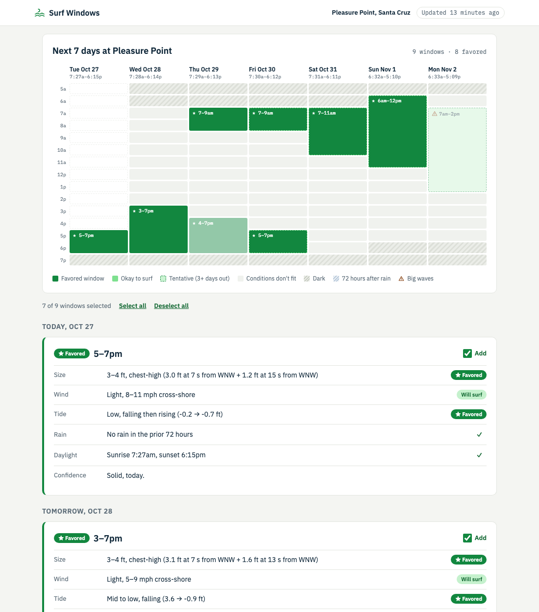

# Surf Windows

**Live:** https://surf-windows.vercel.app · **Subscribe:** https://surf-windows.vercel.app/feed.ics

Good surf windows for Pleasure Point, Santa Cruz, on your calendar. It checks swell, wind, tide, rain and daylight for every hour of the coming week, keeps the hours that match your preferences, and publishes them as a calendar feed you can subscribe to.



## Why

I wanted to plan my work and social life around good surf, without checking forecasts every day.

## How it works

1. **Fetch** swell, wind and rain from Open-Meteo and tide predictions from NOAA. Daylight is computed locally.
2. **Score each hour.** Hard filters first (daylight from an hour before sunrise to an hour after sunset, the 72-hour rain rule), then wave size, wind and tide against preferences that are each *skip*, *will surf* or *favored*.
3. **Merge** good hours into windows and mark favored and tentative ones.
4. **Publish** an HTML page and an iCalendar feed. Vercel's CDN caches both for 30 minutes.

```
Open-Meteo (swell, wind, rain) ─┐
NOAA (tides) ───────────────────┼─> score hours -> merge windows -> page (/) + feed (/feed.ics)
astral (daylight) ──────────────┘
```

## Preferences

Set in `config.yaml`:

```yaml
size:  {waist: ok, chest: fav, head: fav}
tide:  {low: ok, mid: ok, high: skip}
wind:  {glassy: fav, light: ok, windy: skip}
rain:  {skip_after_hours: 72, threshold_in: 0.1}
```

## What I learned

- [fill in after building]

## Roadmap

- [ ] **M1:** Sync to Google Calendar through its API, with a reconciliation loop (stable window IDs, hysteresis, update events in place).
- [ ] **M2:** More spots and traffic-aware "leave by" times.
- [ ] **M3:** A preferences form, with preferences encoded in the feed URL.
- [ ] **M4:** Check forecast windows against buoy observations, and a "was it good?" link to tune thresholds.

## Run locally

```
pip install -r requirements.txt
pytest
vercel dev
```

## Credits

Weather data by [Open-Meteo.com](https://open-meteo.com/). Tide predictions from [NOAA CO-OPS](https://tidesandcurrents.noaa.gov/). Built with Claude Code.
