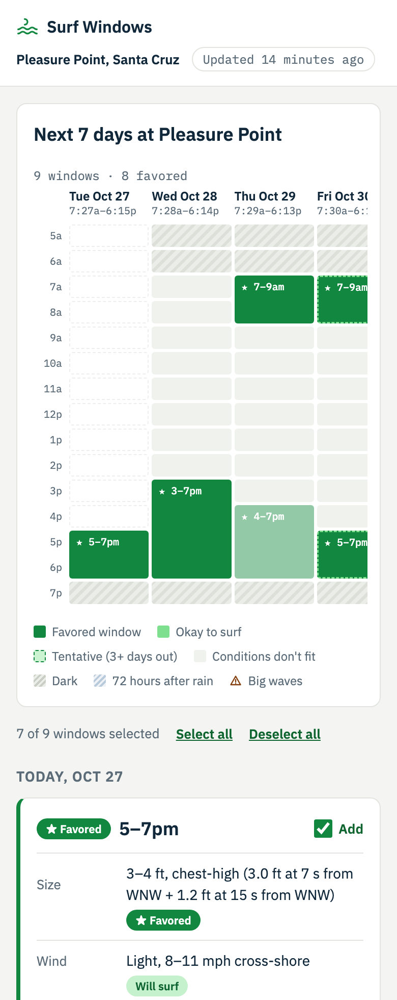

# Surf Windows

**Live:** https://surf-windows.vercel.app · **Subscribe:** https://surf-windows.vercel.app/feed.ics

**Built in one afternoon with Claude Code**, with 56 offline tests. The spec is in [CLAUDE.md](CLAUDE.md), and every decision is logged in [DECISIONS.md](DECISIONS.md).

Good surf is a rare alignment: waves from distant storms have to arrive alongside the right tide, wind, daylight and a few rain-free days. Surf Windows finds the hours at Pleasure Point, Santa Cruz, when they all line up, and puts them on your calendar as a live feed that updates with the forecast, so you can plan meetings and dinner plans around good surf.

<p>
  
  
</p>

## Why

Good surf needs five things to line up at once, and each changes on its own clock:

| Condition | Why it matters | Changes over |
|---|---|---|
| Waves | Energy from storms far out at sea. Too small is flat, too big is dangerous. | Days |
| Tide | Too high and the waves don't break well at this spot. | Twice a day |
| Wind | Calm wind keeps waves smooth; wind blowing onshore makes them choppy. | Hours |
| Rain | Runoff carries bacteria into the water; health officials advise waiting 72 hours. | Days |
| Daylight | You need to see. | Every day |

Forecast apps show the conditions, but I still had to check every day and work out when I was free. Surf Windows turns the forecast into calendar time.

## Use it

- **Read the week.** Dark green windows are favored, light green ones are okay to surf, dashed ones start 3+ days out (tentative), and ⚠ Big waves marks 5–7 ft.
- **Pick your windows.** Every window starts checked; uncheck the ones you'll skip, or use Select all / Deselect all.
- **Add to Google Calendar** subscribes you to the windows you kept. It's a live feed: kept windows update as the forecast moves and new ones are added as they appear. Changing your picks makes a new feed link, so remove the old calendar first.
- **Any other calendar app** can subscribe to the feed URL from Copy feed link.

## How it works

1. **Fetch** every swell partition, wind and rain from Open-Meteo, and hourly tide predictions from NOAA. Sunrise and sunset are computed locally.
2. **Score each hour.** Hard filters first: daylight (from an hour before sunrise to an hour after sunset), and no surf within 72 hours of 0.1" of rain, since stormwater runoff carries bacteria into the water. Then wave size, wind and tide are each scored *skip*, *okay* or *favored*.
   - **Wave size** is estimated on the scale used by Surfline, a popular surf-forecast app (e.g. 3–4 ft+). The model combines every swell, weighting each by its period and direction (west and northwest swells wrap into the point and lose size). Fitted to 59 Surfline forecasts, it lands within one size step of Surfline for 41 of 43 hours in the test week.
   - **Wind** is glassy (under 5 mph, or offshore), light (up to 12 mph) or windy.
   - **Tide** limits are set per break.
3. **Merge** passing hours into windows of 2+ hours. A window is favored when at least half its hours are, tentative when it starts 3+ days out, and flagged when the waves are big.
4. **Publish** the page and an iCalendar feed. Vercel's CDN caches both for 30 minutes.

```
Open-Meteo (swells, wind, rain) ─┐
NOAA (tides) ────────────────────┼─> score hours -> merge windows -> page (/) + feed (/feed.ics)
astral (sunrise, sunset) ────────┘
```

Every non-obvious choice, with the reason for it, is logged in [DECISIONS.md](DECISIONS.md).

## What I learned

- **A swell forecast doesn't tell you how big the surf is at the break.** My first model called the week knee-high while Surfline said 3–4 ft. Fitting a model that accounts for the time between waves and their direction to 59 Surfline forecasts, and testing it on days it hadn't seen, brought it within one size step for 41 of 43 hours.
- **Local knowledge beats generic rules.** "High tide = top third of the day" wiped out a great Sunday. Real Pleasure Point limits (ideal below 3.7 ft, too high from 4.2 ft) fixed it.
- **Explain every decision.** Each hour says why it passed or failed, so bugs were quick to find, like a sunrise rule that dropped every 7am session by one minute.
- **Verify the deployed product, not the deploy log.** The deploy succeeded while the calendar feed was quietly serving the HTML page.

## Preferences

Set in `config.yaml`. The Pleasure Point settings:

```yaml
spot:
  high_tide_ft: 4.2     # tide reaching this is too high
  ideal_tide_ft: 3.7    # staying below this is ideal
preferences:
  size:       {knee: skip, waist: ok, chest: fav, head: fav, overhead: ok, way_over: skip}
  warn_sizes: [overhead]   # 5–7 ft is okay, with a big-wave warning
  tide:       {low: ok, mid: ok, high: skip}
  wind:       {glassy: fav, light: ok, windy: skip}
  rain:       {skip_after_hours: 72, threshold_in: 0.1}
  daylight:   {before_sunrise_min: 60, after_sunset_min: 60}
```

Sizes use Surfline-style feet: knee 1–2, waist 2–3, chest 3–4 (Surfline's "waist to shoulder"), head 4–6, overhead 5–7, and way over 6–8 and up, which is a no-go.

## Roadmap

- [ ] **M1:** Sync to Google Calendar through its API, with a reconciliation loop (stable window IDs, hysteresis, update events in place).
- [ ] **M2:** More spots and traffic-aware "leave by" times.
- [ ] **M3:** A preferences form, with preferences encoded in the feed URL.
- [ ] **M4:** Check forecast windows against buoy observations, and a "was it good?" link to tune thresholds.

## Run locally

```
pip install -r requirements.txt
pytest                              # offline, against tests/fixtures/
python scripts/record_fixtures.py   # refresh the fixtures from the live APIs
vercel dev
```

## Credits

Weather data by [Open-Meteo.com](https://open-meteo.com/). Tide predictions from [NOAA CO-OPS](https://tidesandcurrents.noaa.gov/). Built with Claude Code.
